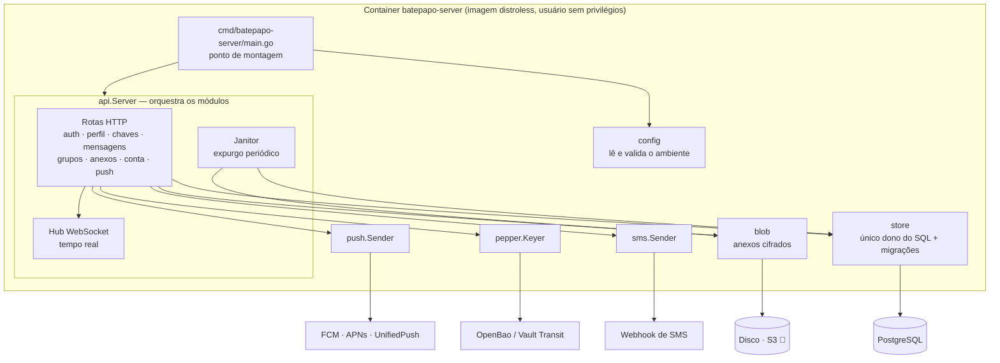
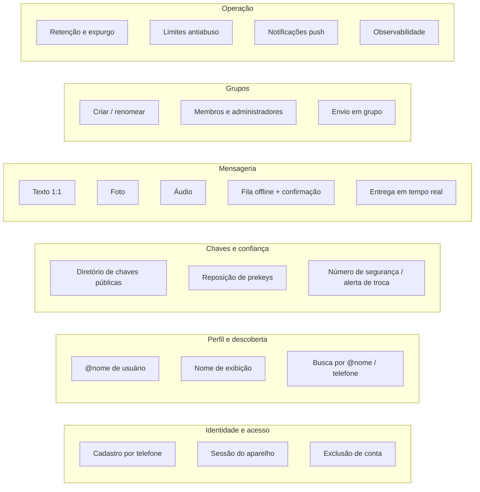
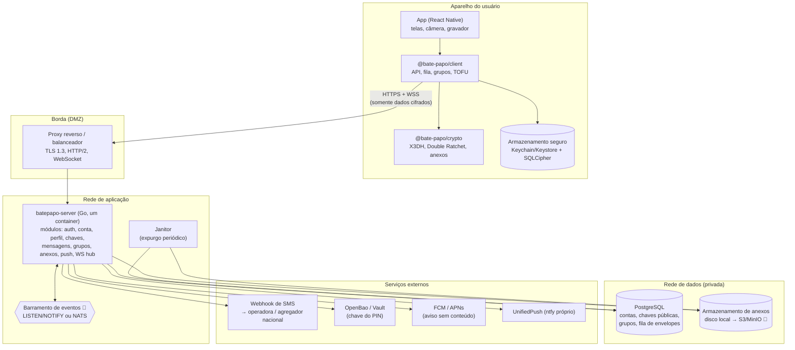
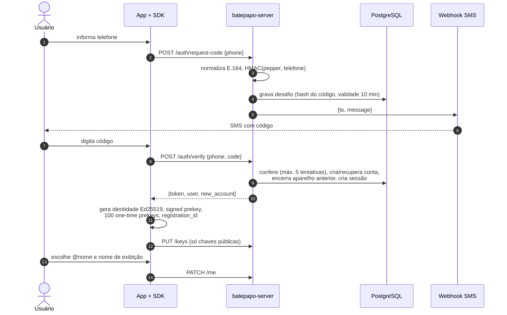
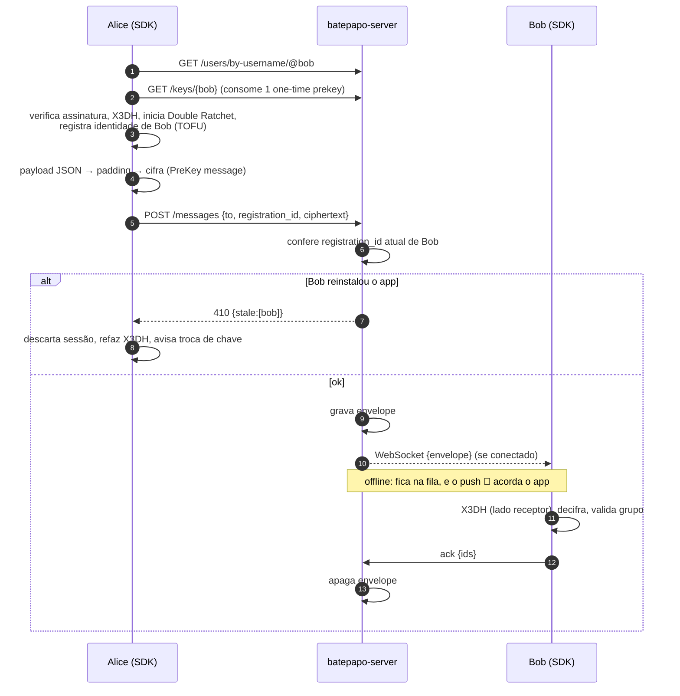
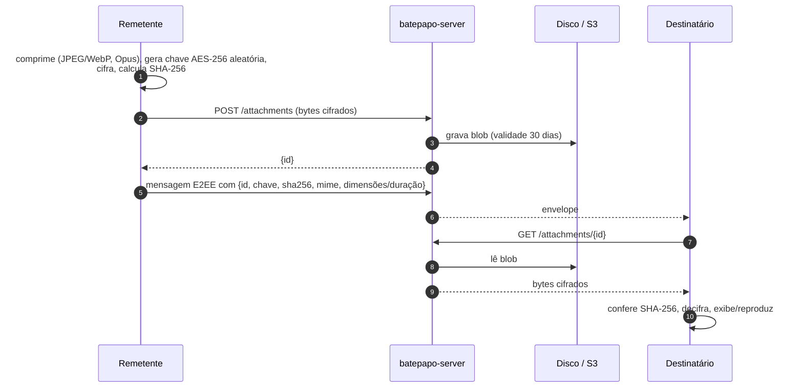
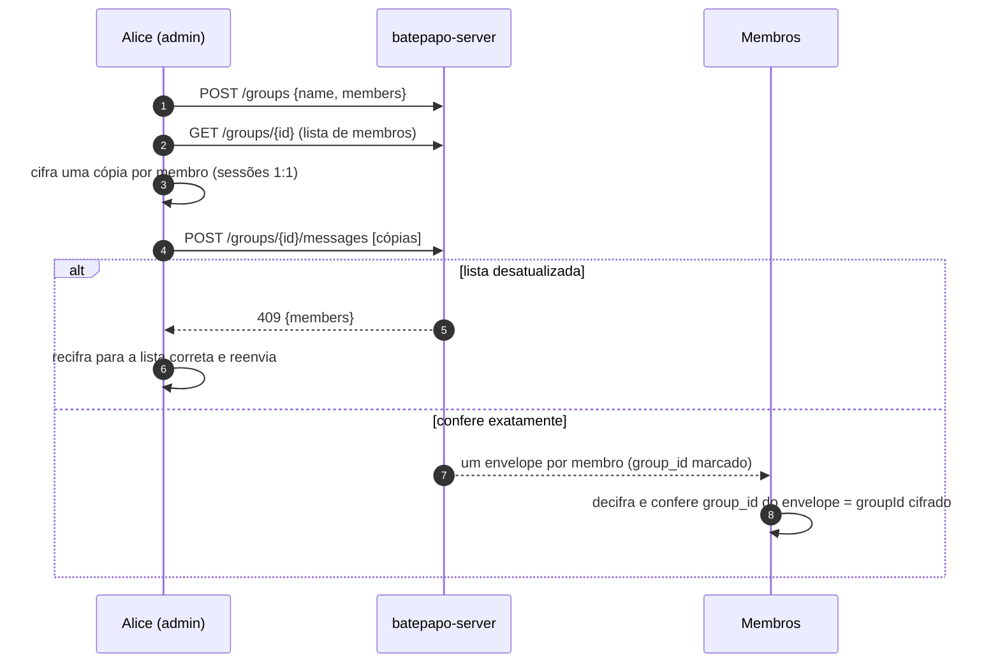
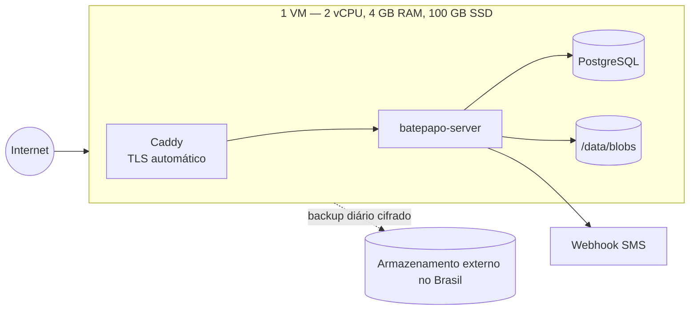
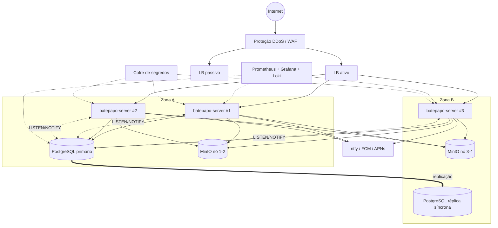
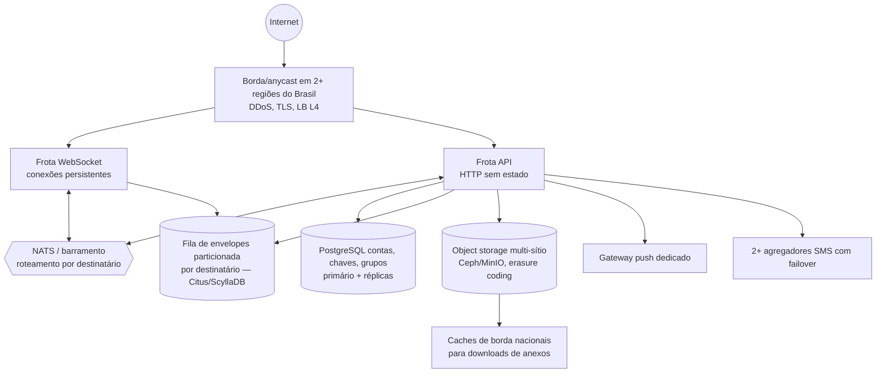

# Arquitetura funcional e infraestrutura de operação

Este documento descreve **o que** o Bate-Papo faz (capacidades funcionais), **como** cada capacidade é realizada pelos componentes, e **de que infraestrutura** uma organização precisa para operar o serviço — de um piloto comunitário até uma operação de escala nacional.

Complementa: [arquitetura.md](arquitetura.md) (visão técnica do código), [seguranca.md](seguranca.md) (protocolo e modelo de ameaças), [api.md](api.md) (referência da API) e [auto-hospedagem.md](auto-hospedagem.md) (configuração do servidor).

Legenda de situação usada ao longo do texto:

- ✅ **implementado** neste repositório e coberto por testes
- 🚧 **planejado** — necessário para operar em produção, ainda não implementado
- 🔭 **futuro** — depois do MVP

---

## 1. Princípios que orientam a arquitetura

1. **Servidor cego ao conteúdo.** Toda a semântica das mensagens (texto, foto, áudio, legenda, grupo) existe apenas dentro do pacote cifrado de ponta a ponta. O servidor transporta bytes opacos.
2. **Coleta e retenção mínimas.** O servidor guarda apenas o necessário para entregar e apaga assim que possível (mensagens são apagadas na confirmação de entrega).
3. **Soberania operacional.** Todos os componentes obrigatórios podem rodar em infraestrutura nacional, com software livre. Dependências estrangeiras inevitáveis (notificações push da Apple/Google) recebem apenas sinais vazios.
4. **Simplicidade para auto-hospedar.** Um binário + PostgreSQL + disco já é um serviço completo. A complexidade cresce só quando a escala exige.
5. **Monólito modular, pronto para separar.** Um único serviço com módulos de fronteiras bem definidas, empacotado em container. Cada módulo pode virar um serviço próprio quando houver um motivo medido para isso (seção 2).

---

## 2. Estratégia de arquitetura: monólito modular em containers

### 2.1 A decisão

O lado servidor do Bate-Papo é **um único serviço, o `batepapo-server`**, escrito em Go e distribuído como **imagem de container**. Dentro dele, cada responsabilidade vive num **módulo separado** (um pacote Go em `server/internal/`), com fronteiras explícitas. As dependências externas (SMS, cofre da chave do PIN, serviços de push, banco, arquivos) entram por **interfaces**, escolhidas pela configuração.

**Não usamos microsserviços nesta fase, de propósito.** O desenho já marca onde cortar quando a escala pedir (seção 2.6), e os cortes seguem os mesmos módulos que existem hoje.

### 2.2 Por que monólito modular agora

| Critério | Monólito modular (escolhido) | Microsserviços |
| --- | --- | --- |
| **Segurança** | Uma única fronteira de rede exposta. Nenhuma credencial trafega entre serviços internos. | Cada serviço é mais uma porta, mais um segredo e mais tráfego interno a proteger (mTLS, políticas de rede). |
| **Soberania e auto-hospedagem** | Prefeitura, universidade ou ONG sobe o serviço com **um container + PostgreSQL**, sem cluster. | Exige orquestrador (Kubernetes), barramento e equipe de plataforma: só grandes operadores conseguem hospedar. |
| **Consistência** | Operações críticas numa só transação. Ex.: registrar o número em outro aparelho apaga sessões, chaves, fila, desafios e token de push **de uma vez**. | Exigiria coordenação distribuída (sagas, eventos), com janelas em que o aparelho antigo ainda funciona — perigoso contra SIM swap. |
| **Operação** | Um artefato, um deploy, um conjunto de logs e métricas. | Versionamento de contratos entre serviços, rastreamento distribuído, mais pontos de falha. |
| **Desempenho** | Chamadas entre módulos são chamadas de função. Um processo Go atende o Nível 1 inteiro (~5 mil usuários) numa VM pequena. | Latência e custo de rede a cada salto. |
| **Escala** | Escala horizontal com réplicas do mesmo container (Nível 2). | Escala cada parte separadamente — vantagem real só na escala nacional (Nível 3). |

### 2.3 Os módulos e suas fronteiras

| Módulo (`server/internal/…`) | Responsabilidade | Depende de |
| --- | --- | --- |
| `api` | Rotas HTTP e WebSocket, regras de cada recurso, hub de tempo real, janitor | todos os abaixo |
| `store` | **Todo** o acesso ao PostgreSQL e as migrações | PostgreSQL |
| `blob` | Guardar e servir anexos (bytes opacos, já cifrados pelo app) | disco (S3 🚧) |
| `sms` | Enviar o código de verificação | provedor via webhook |
| `pepper` | Chave secreta do PIN, fora do banco | variável de ambiente ou OpenBao |
| `push` | Acordar o aparelho, sem conteúdo | FCM, APNs, UnifiedPush |
| `config` | Ler e validar a configuração; recusar opções inseguras em produção | ambiente |
| `phone`, `username` | Normalizar e validar telefone e `@nome` | — |

Regras que mantêm os módulos separáveis:

1. **Só o `store` fala SQL.** Nenhum outro módulo conhece tabelas; se um dia a fila de mensagens for para outro banco, só o `store` muda.
2. **Módulos de integração não se conhecem.** `sms`, `pepper`, `push` e `blob` não importam uns aos outros nem o `api`; quem os combina é o `api`.
3. **Integrações por interface.** Trocar de fornecedor é configuração, não código.
4. **Sem estado escondido.** O que fica em memória (hub, limitadores, intervalo do push) está identificado e é o primeiro alvo para um nível acima (seção 2.6).
5. **Sem dependência circular.** O compilador do Go recusa ciclos entre pacotes, o que impede os módulos de se misturarem com o tempo.

### 2.4 Quem controla os módulos

- **`cmd/batepapo-server/main.go`** é o ponto de montagem (*composition root*). Ele lê a configuração, abre o banco e aplica as migrações. Também escolhe a implementação de cada interface (qual SMS, onde fica a chave do PIN, quais serviços de push), confere na partida que o OpenBao responde, monta o `api.Server`, inicia o janitor e trata o encerramento gracioso (`SIGTERM`).
- **`api.Server`** recebe as peças prontas e roteia cada requisição para o módulo certo. Ele também mantém o **hub** (entrega em tempo real e avisos de grupo), decide quando **acordar um aparelho** por push e roda o **janitor**.
- **`config`** é a barreira de segurança da partida: em produção, o servidor **não sobe** com SMS no console, código exposto, *pepper* padrão, endereços de push internos liberados ou OpenBao sem HTTPS.

### 2.5 Pontos de extensão

| Interface | Implementações | Escolha |
| --- | --- | --- |
| `sms.Sender` | `Console` (desenvolvimento), `Webhook` (qualquer provedor nacional) | `BATEPAPO_SMS_PROVIDER` |
| `pepper.Keyer` | `Local` (variável de ambiente), `Transit` (OpenBao/Vault, com rotação de chave) | `BATEPAPO_PIN_KEY_PROVIDER` |
| `push.Sender` | `FCM`, `APNs`, `UnifiedPush` (vários ao mesmo tempo) | `BATEPAPO_PUSH_*` |
| Anexos (`blob`) | disco local ✅ · S3/MinIO 🚧 | `BATEPAPO_BLOB_DIR` |
| Hub de tempo real | memória ✅ · `LISTEN/NOTIFY` ou NATS 🚧 | — |

### 2.6 Caminho de evolução

A mesma base de código atende os três níveis da seção 6.2. O que muda é **quantas cópias** rodam e **quais módulos** saem para serviços próprios.

| Nível | Forma | O que precisa mudar no código |
| --- | --- | --- |
| **1 — Piloto** (até ~5 mil) | 1 container + PostgreSQL numa VM | nada ✅ |
| **2 — Regional** (até ~500 mil) | N réplicas **do mesmo container** atrás de um balanceador | hub distribuído (`LISTEN/NOTIFY`), limitadores e intervalo do push compartilhados, anexos em S3 🚧 |
| **3 — Nacional** (milhões) | Serviços separados pelos cortes abaixo, ligados por NATS | extrair os módulos em serviços próprios 🔭 |

Cortes previstos para o Nível 3, na ordem em que fazem sentido:

1. **Gateway WebSocket** (hub): conexões persistentes têm perfil de recursos diferente do HTTP sem estado.
2. **Gateway de push** (`push`): isola as credenciais da Apple e do Google e absorve picos de envio.
3. **Fila de envelopes** (parte do `store`): particionada por destinatário, num banco próprio.
4. **Anexos** (`blob`): servidos direto do armazenamento de objetos e de caches de borda.

**Quando separar** — só com motivo medido, por exemplo:

- conexões WebSocket ou memória de uma instância perto do limite, mesmo com réplicas;
- uma parte precisa de deploy ou escala independente (ex.: picos de push);
- isolamento de segredos exigido por auditoria;
- equipes diferentes cuidando de partes diferentes.

### 2.7 Containers e implantação

| Item | Situação |
| --- | --- |
| Imagem `server/Dockerfile`: build estático, base *distroless*, usuário sem privilégios, sem shell | ✅ |
| `docker-compose.yml` para desenvolvimento (servidor + PostgreSQL) | ✅ |
| Migrações na partida com *advisory lock* (várias réplicas podem subir juntas) | ✅ |
| Encerramento gracioso e reconexão automática dos clientes (permite *rolling deploy*) | ✅ |
| Pacote de produção: compose com proxy reverso, TLS, OpenBao e backups | 🚧 |
| Helm chart / manifestos Kubernetes para o Nível 2 | 🚧 |

---

## 3. Mapa de capacidades funcionais

| Domínio | Capacidade | Onde vive | Situação |
| --- | --- | --- | --- |
| Identidade | Cadastro por telefone com código SMS | servidor (`auth.go`) + provedor de SMS | ✅ |
| | Uma sessão por aparelho; novo cadastro encerra o aparelho anterior | servidor (`RegisterDevice`) | ✅ |
| | Exclusão de conta (LGPD art. 18) | servidor (`DELETE /v1/me`) | ✅ |
| | Atestação do aparelho (Play Integrity / App Attest) contra robôs | app + servidor | 🚧 |
| Perfil | `@nome` único, nome de exibição | servidor | ✅ |
| | Busca por `@nome` e por telefone (com limite) | servidor | ✅ |
| | Foto de perfil cifrada | app + servidor | 🔭 |
| Confiança | Publicação e consumo de chaves X3DH | SDK + servidor | ✅ |
| | Reposição automática de *one-time prekeys* | SDK | ✅ |
| | Rotação periódica da *signed prekey* | SDK | 🚧 |
| | Número de segurança, TOFU, alerta de troca de chave | SDK | ✅ |
| | Verificação por QR code, com aviso se a chave mudar depois | app | ✅ |
| Mensageria | Texto, foto e áudio cifrados de ponta a ponta | SDK + servidor | ✅ |
| | Fila para quem está offline, confirmação e remoção | servidor | ✅ |
| | Tempo real por WebSocket com reconexão | SDK + servidor | ✅ |
| | Recibos de entrega/leitura, "digitando…" | SDK (mensagens de controle cifradas) | 🔭 |
| Grupos | Criar, renomear, adicionar/remover, promover admin, sair, avisos em tempo real | servidor | ✅ |
| | Envio em grupo com verificação exata de membros | SDK + servidor | ✅ |
| | Metadados de grupo cifrados, *sender keys* | SDK + servidor | 🔭 |
| Operação | Expurgo por retenção (envelopes, anexos, desafios) | servidor (`RunJanitor`) | ✅ |
| | Limites por IP, telefone e usuário | servidor (memória) | ✅ (instância única) |
| | Notificações push sem conteúdo (FCM, APNs, UnifiedPush) | servidor (`push`) + app | ✅ (UnifiedPush no app 🚧) |
| | Métricas, painéis e alertas | servidor + stack de observabilidade | 🚧 |
| Clientes | App Android/iOS (React Native): cadastro, perfil, conversas de texto | `apps/mobile` | ✅ (fatia 1) |
| | App: fotos, vídeos e mensagens de voz | `apps/mobile` | ✅ |
| | App: grupos, número de segurança com QR code, notificações | `apps/mobile` | ✅ |

---

## 4. Componentes lógicos

### 4.1 No aparelho

| Componente | Responsabilidade | Dados que guarda |
| --- | --- | --- |
| **App** ✅ | Interface, câmera/galeria, gravação de voz, compressão de imagem antes de cifrar, grupos, verificação por QR code, registro de push | preferências (notificações, limpeza de mídia, contatos verificados) |
| **`@bate-papo/client`** ✅ | Cadastro, publicação de chaves, envio com *fan-out* em grupos, tratamento de `410`/`409`, sincronização e confirmação, reconexão do WebSocket, política de troca de identidade | token de sessão, `registration_id`, IDs de contatos confiáveis |
| **`@bate-papo/crypto`** ✅ | X3DH, Double Ratchet, cifra de anexos, padding, número de segurança | — (puro, sem estado próprio) |
| **Armazenamento seguro** ✅ | Chave de 256 bits no Keychain (iOS) / Keystore (Android); `ClientStorage` e histórico num banco SQLCipher | chaves privadas, sessões, histórico de conversas |

O histórico de conversas **só existe nos aparelhos**. O servidor não é fonte de histórico.

### 4.2 No servidor (`batepapo-server`)

Um único binário Go num container, sem estado local além dos anexos em disco, com os módulos abaixo (a estratégia está na seção 2):

| Módulo | Rotas | Tabelas | Observações |
| --- | --- | --- | --- |
| Autenticação | `/v1/auth/*` | `otp_challenges`, `sessions`, `users` | Código de 6 dígitos, 10 min, 5 tentativas; telefone como HMAC; token como SHA-256 |
| Perfil | `/v1/me`, `/v1/users/*` | `users` | Busca por telefone limitada a 120/h por usuário |
| Chaves | `/v1/keys*` | `identity_keys`, `one_time_prekeys` | Consumo atômico de *one-time prekey*; limite de 600 buscas/h por usuário |
| Mensagens | `/v1/messages*`, `/v1/ws` | `envelopes` | Checagem de `registration_id` (410), confirmação apaga |
| Segurança da conta | `/v1/account/*`, `/v1/auth/unlock` | `registration_locks`, `unlock_challenges`, `account_alerts` | PIN (Argon2id + chave fora do banco), código de recuperação, alertas |
| Grupos | `/v1/groups*` | `groups`, `group_members` | Até 256 membros; destinatários = membros exatos (409); aviso em tempo real a cada mudança |
| Push | `/v1/push` | `push_tokens` | Só com o app fechado; texto fixo; no máximo 1 a cada 30 s por mensagens |
| Anexos | `/v1/attachments*` | `attachments` + disco | Até 64 MiB, bytes opacos |
| Hub WebSocket | — | — | Em memória: entrega envelopes, alertas e avisos de grupo só a conexões da mesma instância |
| Janitor | — | todas com validade | A cada hora: envelopes e anexos vencidos, desafios expirados |

### 4.3 Serviços externos

| Serviço | Para quê | Alternativas soberanas | Situação |
| --- | --- | --- | --- |
| **SMS** | Código de verificação | Qualquer agregador ou operadora nacional, via webhook próprio (contrato HTTP simples, ver [auto-hospedagem.md](auto-hospedagem.md)) | ✅ (contrato) |
| **Push Android** | Acordar o app para sincronizar | **UnifiedPush** com servidor **ntfy** próprio; FCM como alternativa | ✅ FCM · UnifiedPush ✅ no servidor, 🚧 no app |
| **Push iOS** | Acordar o app | **APNs é obrigatório** no iOS — por isso o aviso tem texto fixo, sem remetente nem conteúdo | ✅ |
| **Cofre de chaves** | Chave secreta do PIN fora do banco | **OpenBao** (software livre) próprio | ✅ |

---

## 5. Fluxos funcionais

### 5.1 Cadastro e ativação do aparelho

### 5.2 Primeira mensagem para um contato

### 5.3 Foto e áudio

### 5.4 Mensagem em grupo

### 5.5 Ciclo de vida dos dados no servidor

| Dado | Criado em | Apagado em |
| --- | --- | --- |
| Desafio de código SMS | pedido de código | uso, 5 erros ou 10 min (expurgo) |
| Sessão (hash do token) | verificação | logout, novo cadastro do número, exclusão da conta |
| Chaves públicas | ativação do aparelho | novo cadastro do número, exclusão da conta |
| *One-time prekey* | ativação / reposição | primeira busca por outro usuário |
| Envelope (mensagem cifrada) | envio | confirmação de entrega, ou retenção (30 dias) |
| Anexo cifrado | upload | retenção (30 dias) |
| Conta, grupos | cadastro / criação | exclusão da conta / saída do último membro |

---

## 6. Infraestrutura necessária para operação

### 6.1 Recursos por categoria

| Categoria | Recurso | Função | Obrigatório? |
| --- | --- | --- | --- |
| **Rede e borda** | Domínio e DNS | `api.seudominio.br` | sim |
| | Certificados TLS (ACME/Let's Encrypt ou AC nacional) | HTTPS/WSS | sim |
| | Proxy reverso / balanceador (Caddy, Nginx, HAProxy) | TLS, HTTP/2, WebSocket com *timeouts* longos, `X-Forwarded-For` | sim |
| | Proteção DDoS / WAF | volumetria e abuso | a partir de produção |
| **Computação** | Instâncias do `batepapo-server` | API + WebSocket | sim |
| **Dados** | PostgreSQL 16 | estado do serviço | sim |
| | Réplica do PostgreSQL | alta disponibilidade, leitura | a partir de produção |
| | Armazenamento de anexos (disco ou S3/MinIO/Ceph) | blobs cifrados | sim |
| **Integrações** | Agregador de SMS + serviço webhook | códigos de verificação | sim |
| | Servidor ntfy (UnifiedPush), contas FCM e APNs | notificações push | sim, com o app |
| **Segurança** | Cofre de segredos (Vault, OpenBao, KMS) | `BATEPAPO_PHONE_PEPPER`, senha do banco, chaves de push e SMS | a partir de produção |
| | Rede privada / firewall | banco e blobs fora da internet | sim |
| **Operação** | Métricas e painéis (Prometheus + Grafana) | saúde e capacidade | a partir de produção |
| | Logs centralizados (Loki, OpenSearch) | diagnóstico (sem dados pessoais) | a partir de produção |
| | Alertas (Alertmanager) e plantão | resposta a incidentes | a partir de produção |
| | Backups cifrados, fora do sítio, no Brasil | recuperação | sim |
| **Entrega** | Repositório de imagens (registro de containers) e CI/CD | build e deploy | sim |
| | Contas de desenvolvedor Google Play e Apple App Store | publicação do app | sim, com o app |

### 6.2 Topologias de referência

#### Nível 1 — Piloto / comunidade (até ~5 mil usuários)

Para uma associação, escola, coletivo ou prova de conceito.

- Tudo com `docker compose` numa única máquina.
- Disponibilidade esperada: ~99% (manutenções e falhas da VM derrubam o serviço).
- RPO 24 h (backup diário) — aceitável porque o histórico vive nos aparelhos; perde-se no máximo a fila de mensagens não entregues.

#### Nível 2 — Produção regional (até ~500 mil usuários)

Para uma prefeitura, governo estadual, universidade grande ou empresa.

- 3 instâncias do servidor em 2 zonas, atrás de balanceador com afinidade desnecessária (o WebSocket reconecta em qualquer instância).
- PostgreSQL com réplica síncrona e failover automatizado (Patroni ou serviço gerenciado nacional).
- Anexos em MinIO com *erasure coding* (4+ nós).
- Disponibilidade-alvo: 99,9%. RPO ≈ 0 (réplica síncrona), RTO < 15 min.

**Pré-requisitos de código** para este nível (🚧): hub WebSocket distribuído via `LISTEN/NOTIFY`, limitadores de taxa e intervalo do push compartilhados (no PostgreSQL ou Redis/Valkey), armazenamento de anexos S3, endpoint `/metrics`. É o **mesmo container** em várias réplicas (seção 2.6).

#### Nível 3 — Escala nacional (milhões de usuários)

- Separação entre frotas de WebSocket (estado de conexão) e API (sem estado).
- Fila de envelopes particionada por destinatário; contas/chaves/grupos continuam em PostgreSQL.
- Anexos servidos por caches de borda: seguro porque são cifrados, e economiza tráfego de saída.
- Duas regiões no Brasil com recuperação de desastre.

### 6.3 Dimensionamento estimado

Premissas (ajuste com dados reais do piloto):

- 40% dos usuários cadastrados ativos por dia (DAU);
- 50 mensagens enviadas por usuário ativo por dia, com média de **2 destinatários** por mensagem (mistura de 1:1 e grupos) → **100 envelopes/DAU/dia**;
- envelope ≈ 0,5 KB (texto com padding + cabeçalhos), apagado segundos após a entrega na maioria dos casos;
- 10% das mensagens com anexo, média de 150 KB cifrado → **750 KB enviados e 1,5 MB baixados por DAU/dia**;
- pico ≈ 4× a média; 30% dos DAU conectados simultaneamente no pico;
- cada conexão WebSocket ≈ 30–50 KB de memória no servidor Go.

| Métrica | Nível 1 (5 mil usuários) | Nível 2 (500 mil) | Nível 3 (20 milhões) |
| --- | --- | --- | --- |
| DAU | 2 mil | 200 mil | 8 milhões |
| Envelopes/dia | 200 mil | 20 milhões | 800 milhões |
| Envelopes/s (média → pico) | 2 → 10 | 230 → 1 mil | 9 mil → 40 mil |
| Conexões WebSocket no pico | 600 | 60 mil | 2,4 milhões |
| Memória para conexões | < 50 MB | ~3 GB | ~100 GB (frota) |
| Upload de anexos/dia | 1,5 GB | 150 GB | 6 TB |
| Anexos retidos (30 dias) | 45 GB | 4,5 TB | 180 TB |
| Tráfego de saída/dia | ~3 GB | ~300 GB | ~12 TB |
| Banco (contas + chaves) | < 1 GB | ~5 GB | ~200 GB |
| Instâncias do servidor | 1 (2 vCPU) | 3 × 4 vCPU / 8 GB | dezenas, por frota |
| PostgreSQL | mesma VM | 8 vCPU / 32 GB, NVMe, + réplica | cluster + fila particionada |

Observações importantes:

- **A tabela `envelopes` tem rotatividade altíssima** (cada linha vive segundos): ajuste o *autovacuum* agressivamente nela (`autovacuum_vacuum_scale_factor` baixo) e monitore *bloat*. O volume armazenado é pequeno; o desafio é a taxa de escrita.
- **Armazenamento e tráfego de anexos dominam o custo** a partir do nível 2. Reduzir a retenção (ex.: 14 dias) corta o armazenamento proporcionalmente; o histórico continua nos aparelhos.
- **Contas e chaves** ocupam ~10 KB por usuário (principalmente as 100 *one-time prekeys*).

### 6.4 SMS: custo e fraude

- Volume esperado: cadastros novos + reinstalações + trocas de aparelho — tipicamente alguns por cento da base por mês, mais o pico de lançamento.
- **Fraude de SMS (*SMS pumping*)** é o principal risco financeiro: robôs pedem códigos para números premium/internacionais. Mitigações:
  - limites por IP, por telefone e globais (✅ por IP e telefone; global 🚧);
  - restringir códigos de país aceitos (ex.: apenas `+55`) por configuração 🚧;
  - atestação do aparelho (Play Integrity / App Attest) antes de pedir código 🚧;
  - alerta de gasto diário no agregador de SMS.
- Tenha **dois agregadores** com failover no nível 2+: indisponibilidade de SMS impede novos cadastros.

### 6.5 Notificações push ✅

Sem push, o app só recebe mensagens com o WebSocket aberto (app em primeiro plano). Como funciona:

1. O app registra no servidor o token do próprio aparelho: FCM (Android) ou APNs (iOS). O servidor também aceita UnifiedPush; o suporte no app está em construção.
2. Ao gravar um envelope para quem está **sem WebSocket ativo**, o módulo `push` envia um aviso com **texto fixo** ("Você tem novas mensagens"), no máximo uma vez a cada 30 segundos. Alertas de segurança da conta ("Alerta de segurança na sua conta") sempre são enviados.
3. A pessoa abre o app, que conecta, sincroniza e decifra as mensagens.

Assim, Apple e Google só ficam sabendo **que** chegou algo para aquele aparelho, e quando. Não sabem quem falou com quem nem o quê. O token é apagado ao sair da conta, ao registrar o número em outro aparelho e quando o serviço o declara inválido. Endereços UnifiedPush internos são recusados (proteção contra SSRF).

🔭 Futuro: acordar o app em segundo plano para mostrar uma notificação local já decifrada (com o nome de quem enviou), sem que esse dado passe pelo serviço de push.

### 6.6 Segredos e chaves de operação

| Segredo | Impacto se vazar | Impacto se perder | Guarda recomendada |
| --- | --- | --- | --- |
| `BATEPAPO_PHONE_PEPPER` | permite testar quais telefones têm conta | **ninguém mais entra pelo número** (contas órfãs) | cofre de segredos + cópia offline em envelope lacrado / HSM |
| Senha do PostgreSQL | acesso aos metadados | indisponibilidade | cofre, rotação trimestral |
| Credenciais do agregador SMS | envio de SMS às suas custas | sem cadastro | cofre, limite de gasto |
| Chave secreta do PIN (`BATEPAPO_PIN_PEPPER` ou chave no OpenBao) | com o banco, permite testar PINs fora do servidor | todos os PINs param de conferir (contas recuperáveis pelo código de recuperação) | OpenBao Transit (a chave nunca sai do cofre) |
| Chaves APNs / FCM | envio de aviso falso (texto fixo, sem conteúdo) | sem push | cofre |
| Certificados TLS | interceptação de tráfego (conteúdo continua E2EE) | indisponibilidade | ACME automático |

O vazamento total do servidor **não expõe conteúdo de mensagens, fotos ou áudios**.

### 6.7 Observabilidade sem dados pessoais (🚧)

Métricas a expor em `/metrics` (Prometheus), sempre agregadas, nunca por usuário:

- requisições por rota e status, latência p50/p95/p99;
- conexões WebSocket ativas; envelopes enviados/entregues por segundo;
- tempo envelope→confirmação (p95) — principal indicador de experiência;
- profundidade da fila (envelopes pendentes) e idade do mais antigo;
- SMS enviados/falhos; respostas 429 por limitador;
- uso de disco de anexos; expurgos por execução;
- PostgreSQL: conexões, *replication lag*, *dead tuples* em `envelopes`.

**Objetivos de nível de serviço sugeridos (nível 2):**

| Indicador | Objetivo |
| --- | --- |
| Disponibilidade da API | 99,9% ao mês |
| Entrega a destinatário conectado (p95) | < 1 s |
| Sucesso no envio de SMS | > 98% |
| *Replication lag* do PostgreSQL | < 1 s |

Logs: o servidor já registra apenas método, rota (padrão, não o caminho real), status e duração — sem IP, *query string* ou cabeçalhos. Mantenha essa disciplina no proxy reverso (desligue ou anonimize o log de IP, ou retenha por prazo curto e definido em política).

### 6.8 Backup e recuperação

| Item | Frequência | Retenção | Observação |
| --- | --- | --- | --- |
| PostgreSQL | contínuo (WAL) + base diária | 7–30 dias | cifrado, em outro sítio no Brasil |
| Anexos | replicação no object storage | igual à retenção | backup separado é opcional: expiram em 30 dias |
| `BATEPAPO_PHONE_PEPPER` | na criação | permanente | cópia offline |
| Configuração / IaC | a cada mudança | versionado | repositório privado |

Teste a restauração ao menos trimestralmente.

### 6.9 Implantação e mudanças

- **CI** ✅: `gofmt`, `go vet`, testes com `-race`, *typecheck*, testes de criptografia e ponta a ponta contra PostgreSQL real.
- **Imagem** ✅: `server/Dockerfile` (distroless, usuário sem privilégios).
- **Migrações** ✅: aplicadas na inicialização, com *advisory lock* — várias instâncias podem subir ao mesmo tempo. Regra: migrações sempre compatíveis com a versão anterior do servidor (expandir → migrar → contrair), para permitir *rolling deploy*.
- **Deploy**: *rolling* instância a instância; os clientes reconectam o WebSocket automaticamente com *backoff*.
- **Encerramento gracioso** ✅: `SIGTERM` aguarda até 15 s para requisições em andamento.

### 6.10 Soberania e conformidade

- **Localização**: hospede computação, banco, anexos e backups em datacenters no Brasil. Ao escolher provedor, avalie também a **jurisdição da empresa** (legislações estrangeiras podem alcançar empresas sediadas fora do país mesmo com dados no Brasil). Há opções de nuvens nacionais, *colocation* e infraestrutura pública (empresas estatais de TI, redes acadêmicas).
- **Dependências estrangeiras inevitáveis**: APNs (iOS) e, opcionalmente, FCM — mitigadas pelo push vazio. Lojas de aplicativos — mitigável no Android com distribuição via F-Droid/APK próprio.
- **LGPD**: quem opera é o controlador. Mantenha política de privacidade, registro das operações de tratamento, encarregado (DPO), relatório de impacto (RIPD) e procedimento de resposta a incidentes com comunicação à ANPD. Detalhes em [auto-hospedagem.md](auto-hospedagem.md#lgpd).
- **Requisições de autoridades**: o operador só pode entregar o que tem — metadados mínimos listados em [seguranca.md](seguranca.md#o-que-o-servidor-vê-metadados). Publique um relatório de transparência periódico.

---

## 7. Lacunas para operar em produção

Resumo do que falta, em ordem sugerida:

| # | Item | Bloqueia | Esforço |
| --- | --- | --- | --- |
| 1 | Testes do app em aparelhos reais e configuração do Firebase/APNs no build | lançamento | pequeno–médio |
| 2 | Pacote de implantação de produção (compose com proxy, TLS, OpenBao e backups) | Nível 1 em produção | pequeno |
| 3 | Endpoint `/metrics` e painéis | operação nível 2 | pequeno |
| 4 | Lista de países permitidos para SMS, limite global e atestação do aparelho | abuso/custo de SMS | pequeno–médio |
| 5 | Rotação periódica da *signed prekey* | segurança | pequeno |
| 6 | Hub WebSocket via `LISTEN/NOTIFY` e limitadores compartilhados | mais de uma instância (Nível 2) | médio |
| 7 | Armazenamento de anexos S3 (MinIO) e Helm chart | Nível 2 | pequeno–médio |
| 8 | UnifiedPush no app (Android sem Google) | soberania | médio |
| 9 | Mudanças de grupo assinadas pelos administradores | segurança de grupos | médio |
| 10 | Auditoria de segurança independente | versão estável | externo |
