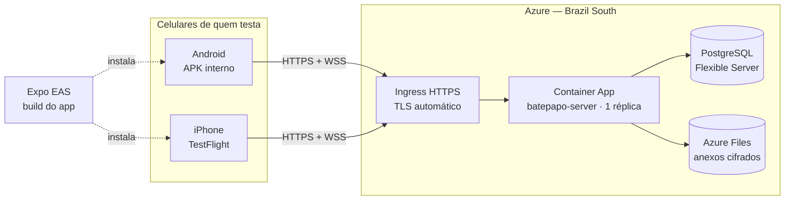

# Guia de testes: servidor na nuvem e app no celular

Este guia leva o Bate-Papo do repositório até o celular de pessoas em lugares diferentes:

1. **Servidor na Azure** (região Brasil), acessível pela internet com HTTPS.
2. **App instalado** em Android e iPhone, sem passar pelas lojas públicas.
3. **Instruções para quem vai testar**, prontas para copiar e enviar.

O ambiente montado aqui é um **teste fechado**: o servidor roda em modo de produção, mas sem provedor de SMS. Só entra quem recebeu um **número de teste** (com código fixo) de você. Assim não há custo de SMS, ninguém de fora consegue se cadastrar e dá para convidar gente de qualquer lugar.



> **Por que uma réplica só?** Hoje o servidor guarda as conexões em tempo real e os limites de tentativas na memória (veja a seção 2.6 de [arquitetura-funcional.md](arquitetura-funcional.md)). Com duas réplicas, uma pessoa conectada numa delas não receberia em tempo real o que chega pela outra. Para um teste, uma réplica pequena sobra.

---

## Parte 0 — O que você precisa

| Item | Para quê | Custo |
| --- | --- | --- |
| Assinatura da Azure | servidor e banco | pago por uso (veja "Custos" na Parte 1) |
| [Azure CLI](https://learn.microsoft.com/cli/azure/install-azure-cli) (`az`) | criar os recursos | gratuito |
| Node.js 22+ e este repositório | gerar o app | gratuito |
| Conta na [Expo](https://expo.dev/signup) e `npm i -g eas-cli` | compilar o app na nuvem (EAS Build) | plano gratuito atende testes |
| **Apple Developer Program** | qualquer instalação em iPhone fora do Xcode | US$ 99/ano |
| Conta Google Play | **não** é necessária para testar no Android (o APK é instalado direto) | — |
| `openssl` | gerar os segredos | gratuito |

---

## Parte 1 — Servidor na Azure

Todos os comandos são para um terminal bash (Linux, macOS, WSL ou o Cloud Shell da própria Azure), a partir da raiz do repositório.

### 1.1 Nomes e segredos

Escolha um sufixo curto e único (só letras minúsculas e números), porque alguns nomes da Azure são globais:

```bash
SUFIXO=bp$(openssl rand -hex 3)          # ex.: bp4f2a91
RG=rg-batepapo-teste
LOCAL=brazilsouth
PG=pg-$SUFIXO                            # servidor PostgreSQL
ACR=acr$SUFIXO                           # registro de imagens
ST=st$SUFIXO                             # conta de armazenamento (anexos)
ENV=env-batepapo
APP=batepapo-server

# Segredos (guarde-os num cofre de senhas: sem o PHONE_PEPPER ninguém mais entra pelo número)
PG_SENHA="Bp1$(openssl rand -hex 16)"
PHONE_PEPPER=$(openssl rand -hex 32)
PIN_PEPPER=$(openssl rand -hex 32)
```

**Números de teste:** um por pessoa, no formato `número=código`, separados por vírgula. Os números não precisam existir (ninguém recebe SMS), mas use números de celular brasileiros válidos no formato. Os códigos precisam ter 6 dígitos e não podem ser óbvios (`123456`, `000000`… são recusados):

```bash
TEST_PHONES="+5511999990001=$(shuf -i 100000-999999 -n1),+5511999990002=$(shuf -i 100000-999999 -n1),+5511999990003=$(shuf -i 100000-999999 -n1)"
echo "$TEST_PHONES"    # anote: cada pessoa recebe o seu par número + código
```

> O código de um número de teste não muda e vale para quem o souber. Entregue cada par a uma só pessoa, por um canal privado. O PIN que a pessoa cria no primeiro acesso é o que protege a conta dela depois.

### 1.2 Preparar a Azure

```bash
az login
az extension add --name containerapp --upgrade

# Assinaturas novas não vêm com todos os serviços liberados. Registre os que o
# guia usa (cada um leva de 1 a 5 minutos; --wait espera terminar):
for ns in Microsoft.App Microsoft.OperationalInsights Microsoft.DBforPostgreSQL \
          Microsoft.ContainerRegistry Microsoft.Storage Microsoft.ManagedIdentity; do
  az provider register --namespace $ns --wait
done

# Todos devem aparecer como "Registered":
az provider list --query "[?contains('Microsoft.App Microsoft.OperationalInsights Microsoft.DBforPostgreSQL Microsoft.ContainerRegistry Microsoft.Storage Microsoft.ManagedIdentity', namespace)].{servico:namespace, estado:registrationState}" -o table

az group create --name $RG --location $LOCAL
```

Se algum comando der `subscription is not registered to use namespace …`, registre o serviço citado com `az provider register --namespace <nome> --wait` e rode o comando de novo. Registrar exige a função de Proprietário ou Colaborador na assinatura.

### 1.3 Banco de dados (PostgreSQL Flexible Server)

```bash
az postgres flexible-server create \
  --resource-group $RG --name $PG --location $LOCAL \
  --tier Burstable --sku-name Standard_B1ms --storage-size 32 --version 16 \
  --admin-user batepapo --admin-password "$PG_SENHA" \
  --public-access 0.0.0.0          # 0.0.0.0 = só serviços dentro da Azure

az postgres flexible-server db create --resource-group $RG --server-name $PG --database-name batepapo

DB_URL="postgres://batepapo:$PG_SENHA@$PG.postgres.database.azure.com:5432/batepapo?sslmode=require"
```

O servidor cria as tabelas sozinho na primeira inicialização (migrações).

### 1.4 Imagem do servidor

O próprio registro da Azure compila a imagem a partir do `server/Dockerfile`, sem precisar de Docker na sua máquina:

```bash
az acr create --resource-group $RG --name $ACR --sku Basic
az acr build --registry $ACR --image batepapo-server:v1 ./server
```

### 1.5 Armazenamento dos anexos (Azure Files)

Fotos, vídeos e áudios chegam ao servidor já cifrados. Eles precisam de um disco que sobreviva a reinícios:

```bash
az storage account create --resource-group $RG --name $ST --location $LOCAL --sku Standard_LRS --kind StorageV2
ST_CHAVE=$(az storage account keys list --resource-group $RG --account-name $ST --query "[0].value" -o tsv)
az storage share-rm create --resource-group $RG --storage-account $ST --name anexos --quota 100
```

### 1.6 Ambiente do Container Apps

```bash
az containerapp env create --resource-group $RG --name $ENV --location $LOCAL

az containerapp env storage set --resource-group $RG --name $ENV \
  --storage-name anexos --storage-type AzureFile \
  --azure-file-account-name $ST --azure-file-account-key "$ST_CHAVE" \
  --azure-file-share-name anexos --access-mode ReadWrite
```

### 1.7 Criar o serviço

O serviço baixa a imagem do registro com uma **identidade gerenciada**, sem senha. O Azure CLI dá a ela a permissão de leitura no registro:

```bash
az identity create --resource-group $RG --name id-batepapo
ID_PULL=$(az identity show --resource-group $RG --name id-batepapo --query id -o tsv)

az containerapp create --resource-group $RG --name $APP --environment $ENV \
  --image $ACR.azurecr.io/batepapo-server:v1 \
  --user-assigned $ID_PULL --registry-identity $ID_PULL --registry-server $ACR.azurecr.io \
  --ingress external --target-port 8080 \
  --min-replicas 1 --max-replicas 1 --cpu 0.5 --memory 1.0Gi \
  --secrets db-url="$DB_URL" phone-pepper="$PHONE_PEPPER" pin-pepper="$PIN_PEPPER" test-phones="$TEST_PHONES" \
  --env-vars \
    BATEPAPO_ENV=production \
    BATEPAPO_DATABASE_URL=secretref:db-url \
    BATEPAPO_PHONE_PEPPER=secretref:phone-pepper \
    BATEPAPO_PIN_PEPPER=secretref:pin-pepper \
    BATEPAPO_SMS_PROVIDER=none \
    BATEPAPO_TEST_PHONES=secretref:test-phones \
    BATEPAPO_TRUST_PROXY_HEADERS=true \
    BATEPAPO_BLOB_DIR=/data/blobs

URL=https://$(az containerapp show --resource-group $RG --name $APP --query properties.configuration.ingress.fqdn -o tsv)
echo $URL
```

O que cada configuração faz:

- `BATEPAPO_ENV=production`: o servidor recusa subir com qualquer opção insegura de desenvolvimento.
- `BATEPAPO_SMS_PROVIDER=none`: só os números de teste se cadastram. Qualquer outro número recebe "cadastro restrito a números de teste".
- `BATEPAPO_TRUST_PROXY_HEADERS=true`: os limites de tentativas passam a valer **por pessoa**. Sem isso, todos pareceriam vir do mesmo IP, o do proxy da Azure, e logo esbarrariam no limite. O servidor usa só o IP que o proxy da Azure acrescenta, que o celular não consegue forjar.
- A **chave secreta do PIN** fica numa variável secreta. Para produção de verdade, use o OpenBao (seção 3.9 de [seguranca-da-conta.md](seguranca-da-conta.md#39-chave-secreta-do-pin-fase-2a)).

### 1.8 Montar o disco dos anexos

O Azure CLI só monta volumes por YAML. Exporte a configuração:

```bash
az containerapp show --resource-group $RG --name $APP -o yaml > app.yaml
```

No `app.yaml`, dentro de `properties.template`, faça duas alterações:

1. No container `batepapo-server`, acrescente `volumeMounts`.
2. No mesmo nível de `containers`, troque `volumes: null` (ou acrescente `volumes`) pelo trecho abaixo.

```yaml
    containers:
    - name: batepapo-server
      # ...o que já estiver aí (image, env, resources)...
      volumeMounts:
      - volumeName: anexos
        mountPath: /data
    volumes:
    - name: anexos
      storageType: AzureFile
      storageName: anexos
      # O servidor roda como usuário sem privilégios (65532); só ele acessa os arquivos.
      mountOptions: uid=65532,gid=65532,dir_mode=0700,file_mode=0600
```

Aplique e apague o arquivo exportado, que contém os segredos:

```bash
az containerapp update --resource-group $RG --name $APP --yaml app.yaml
rm app.yaml
```

### 1.9 Conferir

```bash
curl -s $URL/healthz                                   # {"status":"ok"}
curl -s -X POST $URL/v1/auth/request-code -H 'Content-Type: application/json' \
  -d '{"phone":"+5511999990001"}'                      # {"expires_in":600}  (número de teste)
curl -s -X POST $URL/v1/auth/request-code -H 'Content-Type: application/json' \
  -d '{"phone":"+5511988887777"}'                      # 403 signup_closed  (número comum)
az containerapp logs show --resource-group $RG --name $APP --follow   # logs do servidor
```

### 1.10 Atualizar o servidor

A cada nova versão do código:

```bash
az acr build --registry $ACR --image batepapo-server:v2 ./server
az containerapp update --resource-group $RG --name $APP --image $ACR.azurecr.io/batepapo-server:v2
```

As conexões caem por alguns segundos e o app reconecta sozinho. Os dados ficam no banco e no Azure Files.

Para **acrescentar números de teste**, atualize o segredo e reinicie:

```bash
az containerapp secret set --resource-group $RG --name $APP --secrets test-phones="$TEST_PHONES"
az containerapp revision restart --resource-group $RG --name $APP \
  --revision $(az containerapp show -g $RG -n $APP --query properties.latestRevisionName -o tsv)
```

### 1.11 Custos e como desligar tudo

Os itens que cobram de forma contínua:

- o Container App com uma réplica sempre ligada (0,5 vCPU, 1 GiB);
- o PostgreSQL B1ms;
- o registro Basic;
- poucos GB no Azure Files.

Para um teste, a ordem de grandeza é de algumas dezenas de dólares por mês. Confira na [calculadora de preços da Azure](https://azure.microsoft.com/pricing/calculator/) antes de começar.

Ao terminar o teste, **apague tudo** com um comando. Isso também apaga contas, filas e anexos de quem testou:

```bash
az group delete --name $RG --yes
```

### 1.12 E na AWS?

O mesmo desenho, com os serviços equivalentes, na região `sa-east-1` (São Paulo):

| Azure (este guia) | AWS |
| --- | --- |
| Container Apps | ECS Fargate + Application Load Balancer (suporta WebSocket; aumente o *idle timeout*) |
| PostgreSQL Flexible Server | RDS for PostgreSQL |
| Azure Files | EFS, com *access point* para o usuário 65532 |
| Container Registry | ECR |

O App Runner não serve, porque não suporta WebSocket. As variáveis de ambiente do servidor são as mesmas.

---

## Parte 2 — O app nos celulares

O app usa banco cifrado (SQLCipher), câmera e outros módulos nativos. Por isso **não roda no Expo Go**: é preciso gerar um build próprio. O **EAS Build**, serviço de compilação da Expo, faz isso na nuvem, inclusive o build de iPhone sem precisar de um Mac.

### 2.1 Preparar (uma vez)

```bash
npm install                      # na raiz do repositório
cd apps/mobile
npm i -g eas-cli
eas login
eas init                         # cria o projeto na Expo e grava o projectId no app.json
```

O **identificador do app** precisa ser único na Apple e no Google. Se `br.org.batepapo.app` não for seu, troque `ios.bundleIdentifier` e `android.package` no `app.json` por um domínio que você controle (ex.: `br.com.suaorganizacao.batepapo`).

Aponte o app para o seu servidor. A variável é gravada no app no momento do build:

```bash
eas env:create --environment preview    --name EXPO_PUBLIC_SERVER_URL --value "$URL" --visibility plaintext
eas env:create --environment production --name EXPO_PUBLIC_SERVER_URL --value "$URL" --visibility plaintext
```

O `eas.json` do repositório já traz dois perfis de build:

- **`preview`**: instalação direta (APK no Android, *ad hoc* no iPhone).
- **`production`**: TestFlight ou lojas.

Antes de compilar, o EAS roda o script `eas-build-post-install`, que gera os pacotes `@bate-papo/crypto` e `@bate-papo/client` do monorepo.

### 2.2 Android: APK por link

```bash
eas build --platform android --profile preview
```

Ao final, o EAS mostra um **link e um QR code** da página de instalação. Envie esse link a quem vai testar. A pessoa abre o link no celular Android, baixa e instala o app. O Android vai pedir para permitir instalações dessa origem, e o Play Protect pode avisar que o app é desconhecido; basta prosseguir.

Para uma nova versão, rode o mesmo comando e envie o novo link. Instalar por cima mantém as conversas.

### 2.3 iPhone

A Apple só permite instalar apps fora da App Store com uma conta do **Apple Developer Program**. Há dois caminhos:

| | **TestFlight** (recomendado) | ***Ad hoc*** (instalação direta) |
| --- | --- | --- |
| Quantas pessoas | até 100 internas, sem revisão · até 10 mil externas, por link público | até 100 aparelhos por ano |
| Revisão da Apple | só para externas (*Beta App Review*, geralmente rápida) | não |
| Cada pessoa precisa | instalar o app TestFlight | registrar o aparelho antes do build |
| Validade do build | 90 dias | até o perfil expirar |

#### Caminho A — TestFlight

```bash
eas build --platform ios --profile production
eas submit --platform ios --latest
```

1. Na primeira vez, o EAS pede o login da Apple e cria sozinho o certificado e o perfil.
2. O `eas submit` envia o build ao App Store Connect e cria o registro do app, se ainda não existir.
3. No App Store Connect, abra o app e vá em **TestFlight**.
   - **Testadores internos:** pessoas da sua equipe no App Store Connect, até 100. Recebem o convite na hora.
   - **Testadores externos:** crie um grupo e ative o **link público**. O primeiro build passa pela *Beta App Review*. Nas informações de teste, dê à Apple **um número de teste e o código** e explique que o PIN é criado no primeiro acesso.
4. A pessoa instala o **TestFlight** pela App Store e abre o convite ou o link.

**Criptografia (exportação):** o App Store Connect pergunta se o app usa criptografia. O Bate-Papo usa algoritmos padrão (X25519, AES-256-GCM, SHA-2) para proteger as conversas. Em geral, isso se enquadra nas isenções de "mercado de massa", mas a resposta e eventuais declarações são responsabilidade de quem publica. Confirme com sua assessoria antes de ir para a App Store.

#### Caminho B — *Ad hoc* (poucos aparelhos)

```bash
eas device:create                # gera um link: cada pessoa abre no iPhone e instala o perfil que registra o aparelho
eas build --platform ios --profile preview
```

O link final do build funciona só nos aparelhos registrados até aquele momento. Aparelho novo exige registrar e gerar o build de novo.

### 2.4 Notificações (opcional)

Sem esta etapa o app funciona normalmente: as mensagens aparecem ao abrir o app e, em **Ajustes → Notificações**, aparece "indisponível". Para ligar:

**Android (Firebase Cloud Messaging)**

1. No [console do Firebase](https://console.firebase.google.com/), crie um projeto e adicione um app Android com o mesmo `android.package` do `app.json`.
2. Baixe o `google-services.json` para `apps/mobile/` e acrescente `"googleServicesFile": "./google-services.json"` dentro de `android` no `app.json`. Gere um novo build.
3. Em **Configurações do projeto → Contas de serviço**, gere uma chave privada (JSON) e entregue ao servidor:

```bash
az containerapp secret set -g $RG -n $APP --secrets fcm-json="$(cat conta-de-servico.json)"
```

Monte esse segredo como arquivo, acrescentando ao `app.yaml` da etapa 1.8 um volume do tipo `Secret`, e aponte `BATEPAPO_PUSH_FCM_CREDENTIALS_FILE` para o arquivo montado. Veja [Mounting secrets in a volume](https://learn.microsoft.com/azure/container-apps/manage-secrets#secrets-volume-mounts).

**iPhone (APNs)**

1. No portal Apple Developer, em **Keys**, crie uma chave com **Apple Push Notifications service**. Anote o Key ID e o Team ID e baixe o `.p8`. Ele só pode ser baixado uma vez.
2. Rode `eas credentials`, escolha iOS e configure a chave de push com esse mesmo `.p8`. Gere um novo build.
3. No servidor, monte o `.p8` como arquivo (igual ao JSON do FCM) e defina:
   - `BATEPAPO_PUSH_APNS_KEY_FILE`;
   - `BATEPAPO_PUSH_APNS_KEY_ID`;
   - `BATEPAPO_PUSH_APNS_TEAM_ID`;
   - `BATEPAPO_PUSH_APNS_TOPIC`, com o *bundle id* do app.

   Builds do TestFlight e *ad hoc* usam o ambiente de produção da Apple: **não** defina `BATEPAPO_PUSH_APNS_SANDBOX`.

As notificações dizem só "Você tem novas mensagens". Nada do conteúdo passa pelo Google ou pela Apple (veja [seguranca.md](seguranca.md)).

---

## Parte 3 — Mensagem para quem vai testar

Copie, preencha os campos entre colchetes e envie a cada pessoa, **com o número e o código dela**:

> **Teste do Bate-Papo** 🔒
>
> Você foi convidado(a) para testar o Bate-Papo, um mensageiro brasileiro com criptografia de ponta a ponta. Este é um ambiente de teste: as contas podem ser apagadas ao final.
>
> **1. Instale o app**
> - Android: abra [link do EAS] no celular, baixe e instale (permita a instalação quando o Android pedir).
> - iPhone: instale o app **TestFlight** da App Store e depois abra [link do TestFlight].
>
> **2. Entre com o seu número de teste** (não use o seu número real)
> - Número: **[+55 11 99999-0001]**
> - Código: **[000000]** (não chega por SMS: digite este)
>
> **3. Crie seu perfil e seu PIN.** O PIN protege a conta: guarde-o e guarde também o código de recuperação que o app mostra.
>
> **4. Converse.** Ache as outras pessoas do teste pelo @nome delas e experimente:
> - texto, fotos, vídeos e mensagens de voz;
> - criar um grupo, adicionar e remover pessoas;
> - verificar um contato pelo QR code (toque no ⓘ da conversa);
> - Ajustes → Armazenamento (limpar mídia) e Notificações.
>
> **Achou um problema?** Conte o que fez, o que esperava e o que aconteceu, com o modelo do celular, para [contato ou link de issues].

---

## Parte 4 — Checklist de segurança do ambiente de teste

- [ ] `BATEPAPO_ENV=production` (nunca `development` na internet).
- [ ] `BATEPAPO_DEV_EXPOSE_OTP` **não** definido.
- [ ] Um número de teste por pessoa, entregue por canal privado; códigos aleatórios.
- [ ] Ninguém usa o próprio número real no ambiente de teste.
- [ ] `PHONE_PEPPER`, `PIN_PEPPER` e a senha do banco guardados num cofre de senhas.
- [ ] Banco acessível só de dentro da Azure (`--public-access 0.0.0.0`) e com `sslmode=require`.
- [ ] Ao terminar: `az group delete` (apaga contas, filas e anexos) e remova os builds de teste da Expo e do TestFlight.

Para um serviço aberto ao público, os passos seguintes estão em [auto-hospedagem.md](auto-hospedagem.md):

- SMS real via webhook;
- OpenBao para a chave do PIN;
- backups;
- monitoramento.
