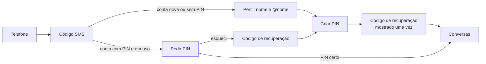

# Segurança da conta

Especificação de como o Bate-Papo protege a **conta** do usuário (quem consegue usar o número e o `@nome` de alguém) e roteiro até a versão de produção.

A proteção do **conteúdo** das conversas é outro assunto, tratado em [seguranca.md](seguranca.md): ela não depende da conta. Mesmo quem toma uma conta não lê o histórico, que só existe no aparelho da vítima, cifrado.

> Guia de decisão usado em todo o documento: **o modelo mais seguro que a pessoa comum consegue usar sem ajuda**. Fricção só quando há risco; nenhuma proteção que dependa de o usuário entender criptografia.

---

## 1. Ameaças consideradas

| Ameaça | Como acontece | Objetivo do atacante |
| --- | --- | --- |
| **SIM swap** | Golpista convence a operadora (ou um funcionário) a transferir o número para um chip dele | Receber o código SMS e assumir a conta |
| **SIM hijacking / portabilidade fraudulenta** | Número levado para outra operadora sem autorização | Idem |
| **Interceptação de SMS** | Falhas na rede de telefonia (SS7), malware no celular, *SMS forwarding* | Ler o código SMS |
| **Engenharia social** | "Me passa o código que chegou aí, foi engano" | Obter o código SMS ou o PIN da vítima |
| **SIM jacker** | SMS especial explora o navegador S@T do próprio chip | Rastrear e controlar o chip, inclusive para ler SMS |
| **Força bruta** | Tentar muitos códigos SMS ou PINs | Adivinhar o segredo |
| **Vazamento do banco do servidor** | Invasão ou funcionário malicioso | Testar PINs offline, sequestrar sessões |
| **Roubo de token de sessão** | Malware ou backup inseguro | Usar a conta sem passar pelo login |
| **Celular perdido ou roubado** | Acesso físico ao aparelho | Ler conversas, usar a conta |
| **Servidor malicioso** | Operador troca as chaves públicas de um contato | Interceptar conversas (ataque de intermediário) |

O **SIM jacker** é uma falha do chip e o app não tem como corrigi-la. Mas a consequência que importa aqui (ler o SMS do código) é neutralizada pela mesma regra que derrota o SIM swap: **o SMS sozinho não basta para assumir uma conta existente**.

## 2. Princípios

1. **O SMS prova a posse do número, não a posse da conta.** Assumir uma conta existente exige um segundo fator.
2. **Nenhum segredo que dá acesso à conta fica em claro no servidor.** O PIN é guardado como HMAC com uma chave secreta **fora do banco** sobre o Argon2id do PIN; código de recuperação e tokens, só como hash.
3. **O dono é avisado na hora** de qualquer tentativa séria, com orientação prática ("procure sua operadora").
4. **Recuperação sempre possível, mas lenta para quem não é o dono.** Esquecer tudo não pode significar perder a conta para sempre; também não pode virar uma porta para atacantes.
5. **O conteúdo não depende da conta.** Tomar a conta não dá acesso ao histórico nem passa despercebido pelos contatos, que veem a troca de chave de segurança.

---

## 3. Modelo implementado (Fase 1)

### 3.1 Cadastro



- **O PIN é obrigatório no app.** Até criá-lo e confirmar que guardou o código de recuperação, a pessoa não chega às conversas.
- **Política do PIN:** 6 a 64 caracteres, números ou letras. São recusadas sequências (`123456`, `abcdef`), repetições (`111111`, `121212`, `123123`) e alguns PINs muito comuns. A mesma regra é aplicada no app (com explicação) e no servidor.
- **Código de recuperação:** 24 caracteres de um alfabeto de 31 símbolos sem ambiguidade (sem `0/O`, `1/I/L`), em grupos de 4, com cerca de 119 bits de entropia.
  - É mostrado uma única vez e pode ser copiado para um gerenciador de senhas; a área de transferência é limpa ao concluir.
  - Aceita minúsculas, espaços e hífens.

### 3.2 Entrar num aparelho novo (troca de celular ou ataque)

| Situação da conta | Código SMS correto leva a |
| --- | --- |
| Não existe | Conta nova |
| Existe, sem PIN | Registro concluído (o aparelho anterior é desconectado) |
| Existe, com PIN, **em uso** nos últimos 7 dias | **`423`** com `lock_token`: o novo aparelho precisa do PIN ou do código de recuperação. **O dono recebe um alerta na hora** |
| Existe, com PIN, **inativa há 7 dias ou mais** | Registro concluído; o PIN antigo é apagado e o novo aparelho precisa criar outro |

Regras do desbloqueio (`POST /v1/auth/unlock`):

- **`lock_token`:** vale **15 minutos** e **5 tentativas**; depois é preciso um novo SMS. Cada SMS custa ao atacante um código novo, e o envio é limitado a 5 por hora por número.
- **PIN errado:** soma uma falha **por conta**, e o dono recebe um alerta a cada erro. Com **10 falhas**, o PIN deixa de ser aceito em aparelhos novos até o dono criar um PIN novo.
- **Código de recuperação:** continua aceito mesmo com o PIN bloqueado, porque a entropia torna a força bruta inviável. É **de uso único**: ao ser usado, o PIN é apagado e o novo aparelho cria PIN e código novos.
- **PIN certo:** o novo aparelho assume a conta (mesmo `@nome` e grupos), o antigo é desconectado e o PIN continua o mesmo.

**Por que liberar a conta depois de 7 dias de inatividade?** É a saída para quem perdeu o celular, o PIN e o código ao mesmo tempo. Um atacante com o chip não consegue esperar 7 dias sem que o dono perceba: o celular dele fica sem sinal, e qualquer uso do app nesse período renova a proteção. O prazo é configurável (`BATEPAPO_LOCK_INACTIVITY_DAYS`). O mesmo desenho é usado pelo Signal.

### 3.3 Alertas ao dono

| Alerta | Quando | O que o app mostra |
| --- | --- | --- |
| `registration_attempt` | Alguém confirmou o código SMS do número em outro aparelho e foi barrado pelo PIN | Aviso em destaque: o chip pode ter sido clonado, procure a operadora, nunca informe PIN ou código |
| `pin_failed` | PIN errado num aparelho novo | Idem |
| `pin_blocked` | 10.ª falha: PIN bloqueado para aparelhos novos | Idem |

Os alertas chegam em tempo real pelo WebSocket e ficam guardados até o dono confirmar que viu (ou por até 30 dias).

### 3.4 Lembrete do PIN

A cada 14 dias o app pede, numa faixa discreta e não bloqueante, que a pessoa confirme o PIN. Isso combate o maior risco do PIN, que é ser esquecido. Errar no lembrete não conta como falha de desbloqueio. O lembrete é limitado a 10 conferências por hora.

### 3.5 Sessões

- **Token de sessão:** 256 bits aleatórios. Fica no banco cifrado do aparelho (SQLCipher com chave no Keychain/Keystore); o servidor guarda só o SHA-256.
- **Expiração:** a sessão expira após **90 dias sem uso** (`BATEPAPO_SESSION_IDLE_DAYS`).
- **Atividade:** conta como atividade qualquer requisição ou uma conexão WebSocket aberta, registrada no máximo a cada 5 minutos. É essa atividade que mantém o PIN valendo.
- **Novo aparelho:** registrar o número em outro aparelho encerra todas as sessões do anterior. Ao reabrir, o aparelho antigo explica o que aconteceu e sugere procurar a operadora se não foi o dono.

### 3.6 Armazenamento no servidor

| Dado | Forma |
| --- | --- |
| Telefone | HMAC-SHA256 com *pepper* |
| PIN | `HMAC-SHA256(chave secreta, Argon2id(PIN, sal))`. Argon2id com t=3, m=64 MiB, p=2 e sal de 16 bytes, no máximo 4 cálculos simultâneos. A chave secreta fica **fora do banco** (seção 3.9) e o banco guarda qual chave foi usada (`pin_scheme`) |
| Código de recuperação | SHA-256 com prefixo de domínio (entropia alta dispensa função lenta) |
| Token de sessão e `lock_token` | SHA-256 |

### 3.7 O que acontece em cada ataque (Fases 1 e 2a)

| Ataque | Resultado |
| --- | --- |
| SIM swap, portabilidade fraudulenta, SMS interceptado, SIM jacker | O SMS confere, mas a conta **não** é entregue sem o PIN. O dono é avisado na hora. |
| Engenharia social pelo código SMS | Inútil sem o PIN. O app e o SMS avisam para nunca repassar códigos. |
| Engenharia social pelo PIN | Ainda possível: é o próximo elo fraco. Mitigado por avisos e, na Fase 2, por passkeys, que não podem ser "ditadas". |
| Força bruta online no PIN | 5 tentativas por SMS e 10 no total. Com PIN de 6 dígitos (10⁶ combinações), a chance é ~0,001%. |
| Força bruta no código de recuperação | Inviável (~2¹¹⁹ combinações). |
| Vazamento **só** do banco do servidor | O PIN **não pode** ser testado offline: o hash depende da chave secreta, que não está no banco. Tokens e códigos não são reutilizáveis a partir dos hashes. |
| Vazamento do banco **e** da chave secreta | Com o provedor `local`, quem tem acesso ao servidor inteiro (variáveis de ambiente) pode testar PINs offline. Com o OpenBao, a chave nunca sai de lá: o atacante precisa consultar o OpenBao, que registra cada consulta e pode limitar a taxa. Proteção completa contra o próprio operador só na Fase 7. |
| Dono esquece PIN e código | A conta é liberada após 7 dias sem uso do aparelho antigo. As conversas antigas se perdem (só existiam naquele aparelho). |

### 3.8 Parâmetros

| Parâmetro | Valor | Configurável |
| --- | --- | --- |
| Validade do código SMS / tentativas | 10 min / 5 | não |
| Pedidos de código por número | 5 por hora, 1 por minuto | não |
| Validade do `lock_token` / tentativas | 15 min / 5 | não |
| Falhas de PIN até bloquear | 10 | não |
| Inatividade que libera a conta | 7 dias | `BATEPAPO_LOCK_INACTIVITY_DAYS` |
| Expiração de sessão sem uso | 90 dias | `BATEPAPO_SESSION_IDLE_DAYS` |
| Lembrete do PIN | 14 dias | no app |
| Retenção de alertas | 30 dias | `BATEPAPO_RETENTION_DAYS` |
| Onde fica a chave secreta do PIN | variável de ambiente | `BATEPAPO_PIN_KEY_PROVIDER` (`local` ou `openbao`) |

### 3.9 Chave secreta do PIN (Fase 2a)

O hash do PIN só é útil para quem também tiver a chave secreta. Há dois provedores:

| Provedor | Onde fica a chave | Quando usar |
| --- | --- | --- |
| `local` | Variável de ambiente `BATEPAPO_PIN_PEPPER` (32 bytes em hex), separada do banco e diferente de `BATEPAPO_PHONE_PEPPER` | Piloto e auto-hospedagem simples. Protege contra vazamento de backup ou dump do banco |
| `openbao` | Dentro do **OpenBao** (ou HashiCorp Vault), motor *Transit*. O servidor só pede "calcule o HMAC disto" e a chave **nunca sai** do OpenBao | Produção. Cada uso fica registrado, a taxa pode ser limitada, a chave pode ser rotacionada e, conforme a instalação, protegida por HSM |

Comportamento:
- **Falha fechada:** se o OpenBao não responder, criar, trocar ou conferir PIN devolve `503` (`code: temporarily_unavailable`) e **nunca conta como PIN errado**. O servidor também se recusa a subir se o OpenBao não responder na partida.
- **Chave trocada por engano:** o banco guarda qual chave gerou cada hash (`pin_scheme`). Se a configuração mudar, a conferência dá erro do servidor (e um log claro), sem descontar tentativas do dono.
- **Rotação (OpenBao):** `bao write -f transit/keys/batepapo-pin/rotate`. Hashes antigos continuam valendo; os novos usam a versão nova.
- **Migração:** PINs criados antes da Fase 2a (Argon2id puro) são convertidos automaticamente na primeira vez que o dono acerta o PIN.
- **Perder a chave** significa que nenhum PIN confere mais. As contas continuam funcionando nos aparelhos atuais, onde o dono pode criar outro PIN, mas trocar de celular exigiria o código de recuperação ou a espera por inatividade. **Faça backup da chave** e guarde-o separado do backup do banco.

#### Configurando o OpenBao

```sh
# 1. Motor Transit e a chave do PIN (não exportável por padrão)
bao secrets enable transit
bao write -f transit/keys/batepapo-pin

# 2. Política mínima: o servidor só pode calcular e conferir HMAC com essa chave
cat > batepapo-pin.hcl <<'HCL'
path "transit/hmac/batepapo-pin/*"   { capabilities = ["update"] }
path "transit/verify/batepapo-pin/*" { capabilities = ["update"] }
HCL
bao policy write batepapo-pin batepapo-pin.hcl

# 3. Token periódico só com essa política (renove com um agente)
bao token create -policy=batepapo-pin -period=24h -orphan

# 4. Recomendado: registro de auditoria e limite de taxa para o Transit
bao audit enable file file_path=/var/log/openbao/audit.log
bao write sys/quotas/rate-limit/batepapo-pin path=transit/ rate=50
```

No servidor Bate-Papo:

```sh
BATEPAPO_PIN_KEY_PROVIDER=openbao
BATEPAPO_OPENBAO_ADDR=https://bao.interno.exemplo.br:8200
BATEPAPO_OPENBAO_TOKEN_FILE=/run/secrets/openbao-token   # relido a cada uso
# opcionais: BATEPAPO_OPENBAO_MOUNT=transit  BATEPAPO_OPENBAO_KEY=batepapo-pin
```

Os nomes dos comandos seguem a CLI do OpenBao (`bao`); no HashiCorp Vault, troque `bao` por `vault`. Confira a disponibilidade de cotas de taxa e de HSM na versão que você usar.

---

## 4. Roteiro até a versão de produção

A ordem segue o maior ganho de segurança pelo menor custo de experiência.

| Fase | Entrega | Protege contra | Experiência do usuário | Esforço |
| --- | --- | --- | --- | --- |
| **1** ✅ | PIN obrigatório, código de recuperação, alertas, lembrete, expiração de sessões | SIM swap, interceptação de SMS, força bruta online | +1 etapa no cadastro; PIN só ao trocar de celular | feito |
| **2a** ✅ | Chave secreta do PIN fora do banco (variável de ambiente ou OpenBao/Vault Transit) | Força bruta offline após vazamento do banco | Nenhum impacto | feito |
| **2b** | **Passkeys** como fator preferido; PIN como alternativa | Engenharia social (passkey não pode ser ditada) e phishing | Melhor que o PIN: trocar de celular com Face ID ou digital | médio |
| **3a** | **Vários aparelhos** e **vinculação por QR** | Dependência do SMS na troca de celular | Trocar de celular sem SMS, aprovando no aparelho antigo | grande |
| **3b** | **Backup cifrado** opcional do histórico | Perda das conversas | Recuperar conversas num celular novo | médio |
| **4** | **Sinais da operadora** (APIs de SIM swap e verificação de número), atestação do app | SIM swap recente, robôs, fraude de SMS | Menos SMS; verificação silenciosa do número | médio |
| **5** | Token preso ao aparelho, bloqueio do app com biometria, lista de aparelhos conectados | Roubo de token, celular desbloqueado nas mãos erradas | Opcional e discreto | médio |
| **6** | **Transparência de chaves** e verificação por QR | Servidor malicioso trocando chaves | Verificação automática; QR para quem quiser | grande |
| **7** | **PIN que o servidor não consegue testar** (OPRF/limiar entre servidores independentes) | Vazamento do banco **e** operador malicioso | Nenhum impacto | grande |
| **Antes do 1.0** | Auditoria independente e programa de recompensa por falhas | O que nós não vimos | — | externo |

### Fase 2a — Chave secreta do PIN fora do banco ✅

Implementada; detalhes e configuração na seção 3.9.

- O resultado do Argon2id passa por um HMAC com uma chave que não está no banco. Com o OpenBao, a chave **nunca sai** do serviço de chaves.
- Um banco vazado deixa de servir para testar PINs: o atacante precisaria também consultar o OpenBao, que registra cada uso e limita a taxa.
- **Próximos passos desta linha:**
  - instalações grandes devem proteger a chave do OpenBao com HSM (selagem por PKCS#11) num datacenter no Brasil;
  - estender o mesmo tratamento ao *pepper* do telefone;
  - a proteção também contra o próprio operador é a Fase 7.

### Fase 2b — Passkeys

- **Cadastro de passkey:** depois do PIN, o app oferece "Usar Face ID / digital para proteger a conta" (WebAuthn/FIDO2). A passkey vira o fator preferido para entrar num celular novo: SMS + passkey, sem digitar nada.
- **Por que melhora a segurança:** a passkey é presa ao domínio do servidor e não pode ser lida em voz alta para um golpista. Isso elimina a engenharia social, que é o ataque que sobra contra o PIN.
- **Por que melhora a experiência:** passkeys sincronizadas (iCloud Keychain, Gerenciador de Senhas do Google) já estão no celular novo da pessoa.
- **Soberania:** passkeys sincronizadas dependem de Apple e Google guardarem a credencial (cifrada de ponta a ponta por eles). Por isso:
  - aceitar também **chaves físicas FIDO2** (ex.: para órgãos públicos);
  - manter o PIN como alternativa sempre;
  - permitir que o operador do servidor desative passkeys sincronizadas por política.
- **Requisitos:**
  - servidor com domínio próprio publicando `/.well-known/assetlinks.json` (Android) e `/.well-known/apple-app-site-association` (iOS);
  - biblioteca WebAuthn no servidor;
  - módulo de passkeys no app.

### Fase 3a — Vários aparelhos e vinculação por QR

- O celular atual mostra/lê um QR no aparelho novo e aprova a entrada com biometria. **O SMS deixa de ser necessário** na troca de aparelho.
- Também habilita o Bate-Papo no computador.
- Exige que o protocolo cifre cada mensagem para todos os aparelhos do destinatário, com uma identidade por aparelho e chaves assinadas pela identidade da conta.
- A lista de aparelhos conectados fica visível em Ajustes, com opção de desconectar cada um.

### Fase 3b — Backup cifrado do histórico

- **Opcional e desligado por padrão:** o histórico é cifrado no aparelho com uma chave derivada de uma senha de backup (ou da extensão PRF da passkey) e pode ser guardado no servidor ou num destino escolhido pela pessoa.
- O servidor nunca consegue ler o backup.
- Sem backup, perder o celular continua significando perder as conversas, e o app deixa isso claro.

### Fase 4 — Sinais da operadora e antifraude

- **APIs padronizadas:** as operadoras brasileiras participam da iniciativa **GSMA Open Gateway**, que padroniza (pelo projeto CAMARA) APIs como:
  - **SIM Swap:** "este número trocou de chip nas últimas X horas?";
  - **Number Verification:** confirma o número pela própria rede móvel, sem SMS.

  Disponibilidade, cobertura e custo precisam ser verificados com cada operadora.
- **Uso pretendido:**
  - Troca de chip recente (ex.: menos de 72 h) → exigir PIN ou passkey **mesmo** se a conta estiver inativa, e adiar a liberação por inatividade.
  - Verificação de número pela rede → cadastro sem digitar código. É melhor para o usuário, imune a interceptação de SMS e mais barato contra fraude de SMS.
- **Atestação do app** (Play Integrity / App Attest) antes de enviar SMS, contra robôs.
- **Limites globais de envio de SMS** e lista de países permitidos.

### Fase 5 — Aparelho e sessão

- **Token preso ao aparelho:** cada requisição é assinada por uma chave guardada no Secure Enclave (iOS) ou StrongBox (Android), que não pode ser copiada (no estilo DPoP). Um token copiado de um backup ou por malware não funciona em outro aparelho.
- **Bloqueio do app** com biometria ou senha do aparelho (opcional), para celular desbloqueado nas mãos erradas.
- **Prévia de notificações** sem conteúdo por padrão.

### Fase 6 — Transparência de chaves

- O servidor publica as chaves de identidade num **log auditável apenas de inclusão** (*key transparency*, como WhatsApp e Apple). Os aparelhos verificam automaticamente se a chave que receberam de um contato é a mesma que todos veem.
- Isso detecta um servidor malicioso que tente se colocar no meio de uma conversa, sem exigir que as pessoas comparem números de segurança.
- A verificação manual por QR continua disponível.

### Fase 7 — PIN que o servidor não consegue testar

- Usar um protocolo de PIN em que o servidor guarda apenas uma parte de um segredo distribuído: OPRF com limite de tentativas imposto em hardware, ou **segredo dividido entre 3 servidores de organizações independentes** (no espírito do SVR3 do Signal).
- Assim, nem um vazamento nem o próprio operador conseguem testar PINs.
- Combina com a proposta de soberania: universidades, entidades e órgãos públicos podem operar as partes.

### Requisitos mínimos para o 1.0 (produção)

- [x] SMS não basta para assumir uma conta (Fase 1)
- [x] Alertas ao dono e recuperação sem perder a conta (Fase 1)
- [x] Chave secreta do PIN fora do banco (Fase 2a); em produção, com OpenBao
- [ ] Passkeys disponíveis (Fase 2b)
- [ ] Atestação do app e limites globais de SMS (Fase 4, parcial)
- [ ] Auditoria de segurança independente, com correções publicadas
- [ ] Programa de divulgação responsável e recompensa por falhas ativo
- [ ] Política de privacidade e relatório de impacto (RIPD) publicados

---

## 5. API (resumo)

| Método | Rota | Uso |
| --- | --- | --- |
| POST | `/v1/auth/verify` | `423 {code: "registration_locked", lock_token, attempts_left, expires_in}` se a conta tem PIN |
| POST | `/v1/auth/unlock` | `{lock_token, pin}` ou `{lock_token, recovery_code}` → sessão. Erros com `code`: `wrong_pin` (+`attempts_left`), `pin_blocked`, `wrong_recovery_code`, `expired`, `too_many_attempts` |
| GET | `/v1/account/lock` | `{enabled, created_at, failed_attempts}` |
| PUT | `/v1/account/lock` | `{pin}` → `{recovery_code}` (define ou troca o PIN; zera falhas) |
| DELETE | `/v1/account/lock` | Remove o PIN (o app não oferece esta opção) |
| POST | `/v1/account/lock/check` | `{pin}` → `{ok}` (lembrete; 10 por hora) |
| POST | `/v1/account/recovery-code` | Novo código; o anterior deixa de valer |
| GET | `/v1/account/alerts` | Alertas pendentes |
| POST | `/v1/account/alerts/ack` | `{ids}` |
| WebSocket | `/v1/ws` | `{"type": "alert", "alert": {...}}` em tempo real |
